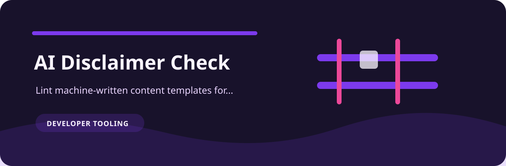

# AI Disclaimer Check



Lint AI-generated content templates for disclosure and unsupported-claim gaps.

`Python`

## Start here

```bash
git clone https://github.com/mertefekurt/ai-disclaimer-check.git
cd ai-disclaimer-check
python -m pip install -e ".[dev]"
ai-disclaimer-check examples/sample.txt
```

## Project map

```text
.github/        CI workflow
examples/       sample inputs
src/            package source
tests/          test coverage
```

## Repository

[Open the source on GitHub →](https://github.com/mertefekurt/ai-disclaimer-check)

[MIT License](LICENSE)
